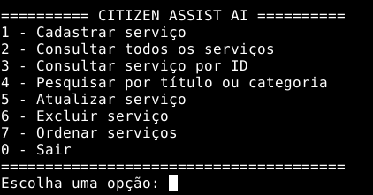
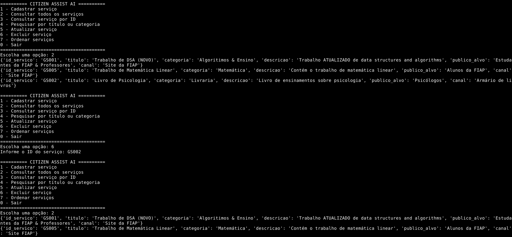

# Testes realizados com o código e suas evidências

## 1. Cadastro

## 2. Consulta

### 2.1. Consultar todos os serviços

### 2.2. Consultar por ID

### 2.3. Consultar por Título ou Categoria

## 3. Atualização

## 4. Exclusão

## 5. Ordenação

### 5.1. Ordenação pelo Título

### 5.2. Ordenação pelo ID

## 6. Tratamento de entradas inválidas
### 6.1. Opções inexistentes

### 6.2. Valores Incompatíveis

### 6.3. Campos Obrigatórios Vazios

### 6.4. Identificadores Duplicados
